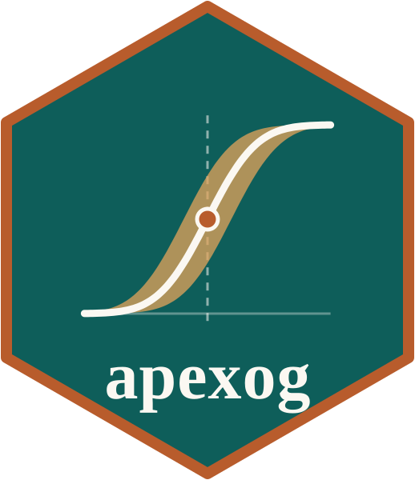

# apexog 

**Plausibly exogenous bounds for average partial effects in binary-outcome IV
models.**

Documentation, a getting-started guide in R and in Stata, and guides to the
options: **<https://jespernwulff.github.io/apexog/>**

How large would a violation of the exclusion restriction have to be before the
average partial effect from your probit changes sign, or stops being
significant? apexog carries the plausibly exogenous framework of Conley, Hansen
and Rossi (2012) from linear 2SLS coefficients to average partial effects and
average interaction effects on the probability scale. The models are estimated
by a control-function probit (linear, probit, fractional-probit or Poisson
first stage; Murphy–Topel two-step standard errors) or, for one binary
treatment, a recursive bivariate probit. At every assumed violation *γ* the
model is refitted with *z'γ* as an offset in the latent index. The result is
summarized as a union of confidence intervals over a range for *γ*, or as a
local-to-zero interval under a prior for *γ*.

This is the R package. The Stata command of the same name is at
[jespernwulff/stata-apexog](https://github.com/jespernwulff/stata-apexog); the
two give the same results.

## Installation

```r
# install.packages("remotes")
remotes::install_github("jespernwulff/apexog")
```

## Example

```r
library(apexog)
data(promotion)

apexog(promoted ~ tenure + manager, endog = training ~ subsidy,
       data = promotion, method = "uci", gmin = -0.10, gmax = 0.10, grid = 11)
#> Baseline (gamma = 0):
#>     APE(training)      = 0.144457  (SE 0.008323)  [0.128145, 0.160769]
#> ...
#> UCI union over gamma grid (11 point(s) per instrument):
#>     gamma_subsidy  range: [-0.1000, 0.1000]   exact Pr scale: [-0.0209, 0.0209]
#>
#>     APE(training)      bounds = [0.097219, 0.190375]
```

Training is endogenous and a training subsidy is the instrument. If the
subsidy's direct effect on promotion lies between −0.10 and 0.10 on the latent
index (about ±2 percentage points), the average partial effect of training lies
between 0.097 and 0.190 with at least 95% confidence. See
[Get started](https://jespernwulff.github.io/apexog/articles/apexog.html).

## Citation

Conley, T. G., Hansen, C. B., & Rossi, P. E. (2012). Plausibly exogenous.
*Review of Economics and Statistics*, 94(1), 260–272.
<https://doi.org/10.1162/REST_a_00139>

Wulff, J. N. (2026). *apexog: Plausibly exogenous bounds for average partial
effects in binary-outcome IV models.* R package and Stata command, version
0.20.1. <https://jespernwulff.github.io/apexog/>

## License

MIT © Jesper N. Wulff
